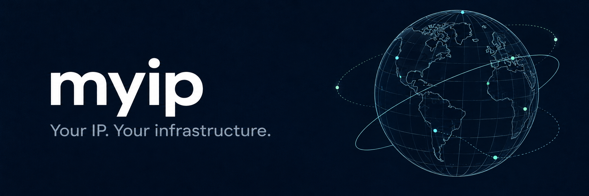

<p align="center">
  A fast, self-hosted IP intelligence API. Local lookups. No per-request upstream calls.
</p>

<p align="center">
  <a href="docs/REFERENCE.md">Documentation</a> ·
  <a href="DEPLOYMENT.md">Deployment</a> ·
  <a href="CONTRIBUTING.md">Contributing</a>
</p>

## ✨ Small API. Solid foundations.

- **IPv4 + IPv6** — location, network, country flags and timezone information.
- **Local-first** — MaxMind + DB-IP, with optional IPinfo enrichment.
- **Verified updates** — SHA-256 inventories, atomic snapshots and SQLite audit history.
- **Built to operate** — Docker, Prometheus, trusted proxies and RPM/RPS limits.

Built with Go’s standard `net/http` and `http.ServeMux`. No external database server required.

## 🚀 Quick start

Requires Docker and Docker Compose—no source checkout or Go installation.

```bash
mkdir -p myip && cd myip
curl -fsSLo compose.yml https://raw.githubusercontent.com/TrueFix/ip/main/deploy/compose.dbip.yml
docker compose pull
docker compose up -d
curl http://localhost:8080/8.8.8.8
```

The first database download takes a little time; `/healthz` returns `503` until ready.
Localhost itself is not a public IP, so use an explicit IP for local testing.

No credentials or `.env` needed for this DB-IP template. For MaxMind, use the
[easy deployment guide](DEPLOYMENT.md)—its template requires both credentials
before Compose will start.

Source-specific `.env` examples and every setting explained:
[Environment variables](docs/ENVIRONMENT.md).

Both containers use **[mayankfawkes/ip](https://hub.docker.com/r/mayankfawkes/ip)**
(amd64/arm64). Pin a release by editing both Compose image tags; otherwise `latest` selects
the latest stable release. Images become available after the first version-tag push.

### Choose your data

| Setting | Behavior |
| --- | --- |
| [MaxMind template](deploy/compose.maxmind.yml) | MaxMind primary + DB-IP fallback; account ID and license key required. |
| [DB-IP template](deploy/compose.dbip.yml) | DB-IP only; no account needed. |
| `IPINFO_ENABLED=true` | Optional network enrichment in MaxMind mode; free IPinfo token required. |

Locations are approximate. Missing data stays `null`—never guessed.
See the [configuration guide](docs/REFERENCE.md#configuration) for credentials and options.

## 🔌 Endpoints

| Route | Purpose | Port |
| --- | --- | --- |
| `GET /` | Look up the caller | `8080` |
| `GET /<ip>` | Look up any public IPv4 or IPv6 | `8080` |
| `GET /healthz` | Readiness | `8080` |
| `GET /metrics` | Prometheus metrics | `9090` · private |
| `GET /databases` | File inventory and update status | `9090` · private |

Response links automatically follow the request’s host and scheme. No base URL configuration needed.

## 🛡️ Before going public

Keep port **9090 private**, configure HTTPS and trust only your actual reverse proxy.
Rate limits are **per-process memory budgets**; they reset on restart and are not shared across replicas.
Set `RATELIMIT_ENABLE=false` in `.env` to disable all built-in limiting, then
run `docker compose up -d`. Default: `true`. Requires **v0.1.4 or newer**;
keep edge protection. See [rate-limit settings](docs/ENVIRONMENT.md#5-rate-limiting--no-authentication).

Keep `.env`, tokens and downloaded data out of Git. Data defaults to `./data` locally and `/data` in Docker.

Follow the [production checklist](deploy/PRODUCTION.md) before exposing the service.

## 🛠️ Development

Requires Go 1.27+ and Python 3.

```bash
make hooks
make check
make audit
```

For local runs, benchmarks, SQLite history and the full response schema, see the [reference](docs/REFERENCE.md).

Prefer binaries? [GitHub Releases](https://github.com/TrueFix/ip/releases) provide
raw API executables and SHA-256 checksums—no archives or helper executables.

| OS | Targets |
| --- | --- |
| Linux | 15 variants, including x86, ARM, MIPS, PowerPC, RISC-V, LoongArch and s390x |
| macOS | Intel and Apple Silicon |
| Windows | x86, x64 and ARM64 (`.exe`) |

Static Linux builds work across compatible distros without glibc/musl-specific
packages. See the [full target list](scripts/release-targets.txt). Raw binaries
need provisioned databases; Docker remains easiest for automatic updates.

---

[MIT license](LICENSE) · [Data licenses & attribution](THIRD_PARTY.md) · [Security](SECURITY.md)
